# 小鲸鱼输入法（Whale IME）

> 随着 AI 的发展，软件进入客制化时代，用户可以自己定义所需软件的任何细节、功能、界面。小鲸鱼输入法就是这样一个客制化的输入法

> 为什么叫“小鲸鱼输入法”？因为整个输入法的编码实现、debug、编译、性能优化都是蓝色大肥鱼（`deepseek-v4.1-flash-1017`）完成的
<div align="center">
  
</div>


小鲸鱼输入法是一款完全离线的安卓中文输入法，基于开源的 [Rime](http://rime.im)（中州韵，librime 1.17.0）引擎构建，界面层采用 Jetpack Compose，使用 Kotlin 编写。所有输入、候选、词典与手写识别能力均在本地完成，无需联网，不采集任何用户数据，注重隐私与输入效率（详见 [隐私政策](privacy-policy.md)）。

## 界面预览

<table width="100%">
  <tr>
    <td align="center" valign="top" width="33%">
      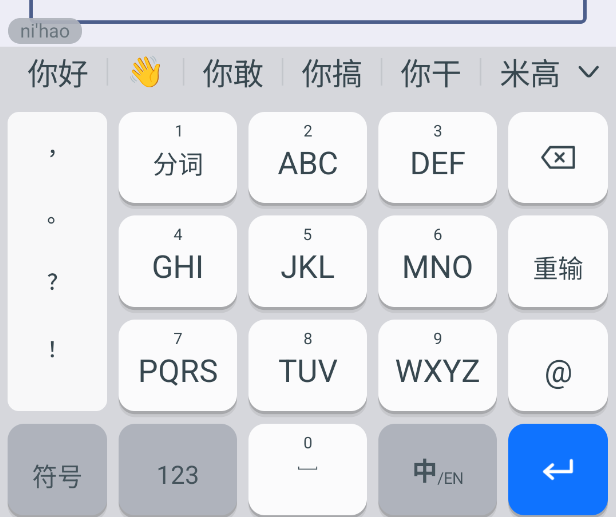<br>
      <sub>九宫格（T9）</sub>
    </td>
    <td align="center" valign="top" width="33%">
      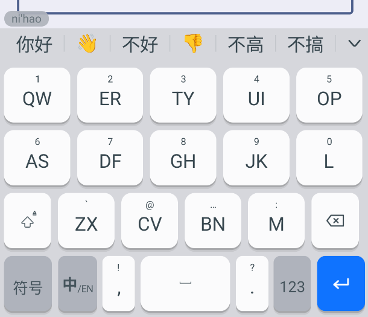<br>
      <sub>14 键</sub>
    </td>
    <td align="center" valign="top" width="33%">
      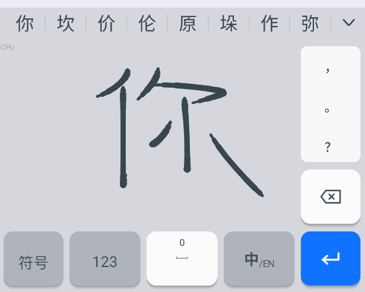<br>
      <sub>手写识别</sub>
    </td>
  </tr>
  <tr>
    <td align="center" valign="top" width="33%">
      <br>
      <sub>邻键纠错 / 模糊音</sub>
    </td>
    <td align="center" valign="top" width="33%">
      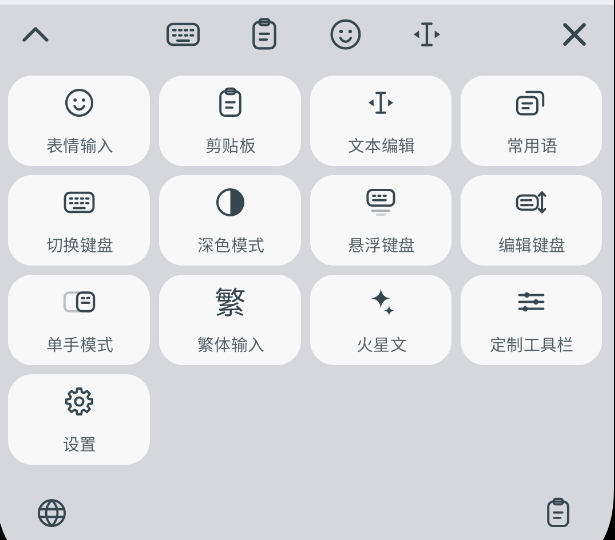<br>
      <sub>快捷功能</sub>
    </td>
    <td align="center" valign="top" width="33%">
      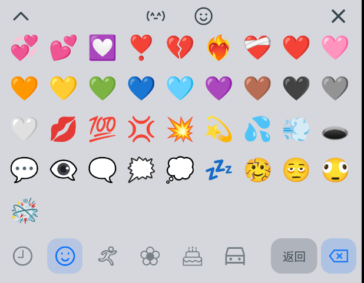<br>
      <sub>表情 / 颜文字</sub>
    </td>
  </tr>
  <tr>
    <td align="center" valign="top" colspan="3">
      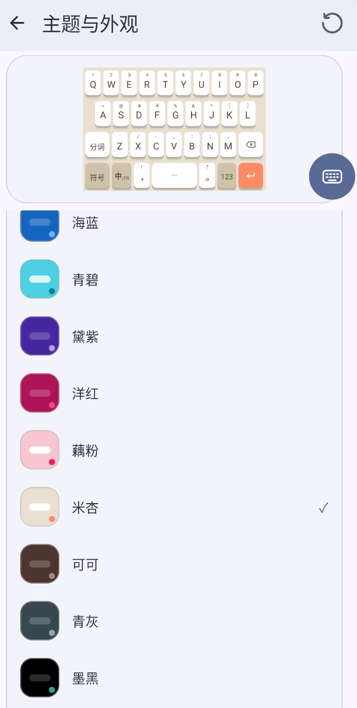
      &nbsp;&nbsp;&nbsp;&nbsp;
      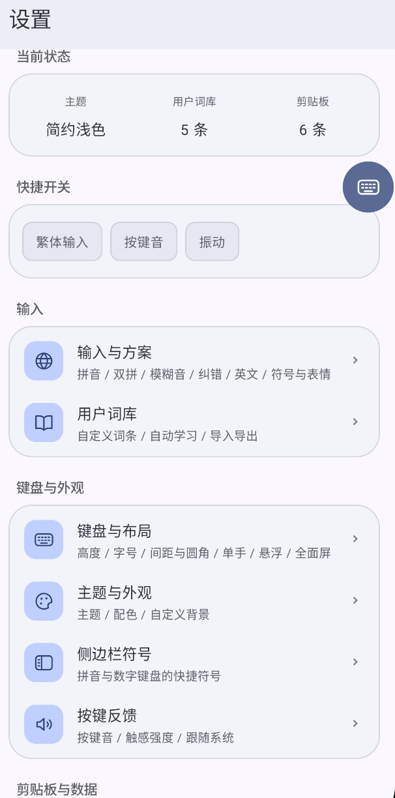<br>
      <sub>多彩主题与设置界面</sub>
    </td>
  </tr>
</table>

## 功能特性

- **多种输入方案**：全拼 26 键、14 键（`QW/ER/TY/UI/OP · AS/DF/GH/JK/L · ZX/CV/BN/M`）、T9 九宫格、双拼（小鹤、自然码、智能 ABC、微软、搜狗、紫光六种）、笔画、英文、手写，可在键盘上随时切换。
- **拼音容错能力**：引擎原生邻键纠错（纠错项以「?」标注）、模糊音，以及 j/q/x/y 后的 v 视作 u；14 键方案有等价的键码层规则，开关实时生效。
- **智能候选与自学习**：基于白霜拼音（rime-frost）词库、随包 octagram 语法模型（`zh-hans.gram`，负责整句排序）与 23 个细胞词库（长尾补充）；支持上下文联想与日期/时间快捷候选；候选面板带读音栏筛选与「读音试打」、分段选词、长按弹层滑动选字；中文输入下还能按谐音或英文名输出希腊字母（α/β/Ω…）。用户词库自动记录选词纠偏，编码精确匹配时置顶注入，并可在设置中管理、随备份包导入导出。
- **中英混输与智能改写**：中文↔数字、中文↔字母交界自动补空格；英文补全、英文句首自动大写、英文标点后补空格；英文词条检索大小写不敏感而候选保持词库原文；聊天输入框的回车键可切换成「发送」（点击发送、长按换行）。
- **离线手写识别**：采用开源端到端手写识别方案（MobileNetV2 → NCNN INT8 量化），覆盖 GB2312 一级 3755 字，候选走与拼音一致的选词管线；笔迹粗细、识别灵敏度、停笔自动上屏均可调。模型无法加载的设备（如缺 x86_64 手写库的模拟器）会自动隐藏手写入口，上次停留在手写模式时回落到中文 26 键。
- **丰富的辅助输入**：常用语（快捷码可参与候选，默认关闭；编辑为候选栏上方的独立弹层，支持整句换行与点按定位光标）、日期时间快捷键、剪贴板历史（50~1000 条、列表/网格/瀑布流三种布局、粘贴建议）、表情 / 颜文字 / 符号面板（各自的最近使用记录）、火星文、希腊字母、简体转繁体、数字键盘上的表达式计算，以及九宫格/数字键盘的侧边符号与拼音前缀栏。
- **灵活的键盘布局**：全键盘、14 键、九宫格、笔画、数字、符号、手写、文本编辑等多种布局；支持单手模式、悬浮键盘（可拖拽）、横屏适配、全面屏键盘优化（左/中/右功能位可配），以及常驻工具栏的长按拖拽排序；26 键/14 键的「中/EN」与「123」键位可整键互换。
- **手势与手感**：空格左右滑动移动光标（速度可调）、删除键左滑清空、上滑输入键帽小标点、长按弹层滑动选字、长按连发；键盘高度与底部留白可在「编辑键盘」浮层里直接拖动调整。
- **物理键盘支持**：外接键盘时可显示跟随光标的浮动候选栏，也可选择继续显示软键盘。
- **主题与外观定制**：23 款内置主题（简约/原生浅深色、透明浅色 + 18 档纯色色卡），自定义主题支持背景图裁剪、亮度与浅/深键帽，深色模式跟随系统；候选字号、键帽字号/粗细、按键间距、圆角、符号上滑档位等均可单独调节。
- **按键反馈**：音效与触感分别开关，支持「跟随系统」或应用内 1~5 档强度。
- **数据自主与备份**：备份包（zip v2）按分类导出/恢复——用户词典、学习词、剪贴板、常用语、符号、设置分组、主题、Rime 用户目录，导入时可选覆盖或合并；可定期自动备份到用户授权的目录，只保留最近 5 份。
- **声明式设置界面**：所有偏好集中管理、按元数据自动渲染，支持拼音首字母搜索、设置页内试输入悬浮球、键盘端深链跳转；首次启动展示隐私政策，未启用输入法时给出启用/切换引导。

## 设计与架构

### 模块划分

仓库为单仓多模块结构：

| 模块 | 职责 |
| --- | --- |
| `app` | 应用外壳：Application 初始化、签名/版本/ABI 配置、输入法服务与桌面入口声明，几乎不含业务代码 |
| `ime-native` | 原生引擎与引擎数据：`libwhaleime.so`、手写 CMake 工程、Rime 词典/语法模型/手写模型/字体等 assets |
| `ime-core` | 运行时与引擎：偏好、Room、主题、键盘模型、`InputDispatcher`/`DictDecoder`、Rime/HW/Custom 引擎、备份与用户词（无 Compose） |
| `ime-ui` | Compose 键盘与设置界面、Activity、`ImeService`、自动备份任务、全部应用资源 |
| `ime-vendor` | vendored 第三方源码：pinyin4j（拼音/简拼）与表达式求值，零项目依赖 |

依赖只允许向下：`app → ime-ui → ime-core → ime-vendor`；`ime-native` 是只被 `app` 以 `runtimeOnly` 打包的载荷模块（没有任何模块编译期依赖它）。

包约定如下：

- `com.whale` —— 应用外壳（`BaseApplication`）；
- `com.whale.ime.*` —— 三个库的全部代码；资源 ID 按模块划分（`com.whale.ime.core.R` / `com.whale.ime.ui.R`），资源必须放在引用它的模块里；
- `com.whale.ime.vendor.{pinyin4j,expression}` —— vendored 第三方代码，在 `:ime-vendor` 内。包内不得 import 任何宿主类型；拼音表由 `PinyinHelper.init(AssetManager)` 注入，调用点在 `Launcher.currentInit()` 第一行；
- `com.whale.ime.engine`（+ `engine/schema`）—— 引擎层（`RimeEngine`、`HWEngine`、`CustomEngine`、`GreekAlphabet`），以及拼音键位换算（`T9PinYinUtils` / `T14KeyUtils` / `T14KeyMap` / `DoublePinYinUtils`）与纠错配置 `CorrectionSchema`；
- `com.whale.ime.rime` —— Rime JNI 绑定（`Rime`/`Structs`/`RimeKeycode`）。**包名不可改**：它是 `libwhaleime.so` 的 ABI（`Java_com_whale_ime_rime_Rime_*` 与 `FindClass("com/whale/ime/rime/*")`）；改包名必须同步改 `ime-native/native/src/whale_jni.cpp` 并重编引擎。界面层不得直接触碰 Rime JNI；
- `com.whale.ime.handwriting` —— 手写识别入口，符号声明在 `ime-native/src/main/cpp/hccr/hccr_jni.cc`。

方案 ID 是 `config/SchemaIds` 里的字符串常量：`t9_pinyin` / `t14_pinyin` / `pinyin` / `english` / `stroke` / `handwriting` / `double_pinyin_`（前缀，后接小鹤等方案名）。九键与 14 键的输入串是「大写键码」，凡需要区分「键码 / 拼音」的地方统一用 `SchemaIds.isKeyCodeSchema()` 判断。

原生引擎 `libwhaleime.so` 并非闭源黑盒：其源码位于 `ime-native/native`（librime 1.17.0 + JNI 桥接与自研插件），可通过 `scripts/build-engine.ps1` 从公开源码完整重建。

### 启动流程

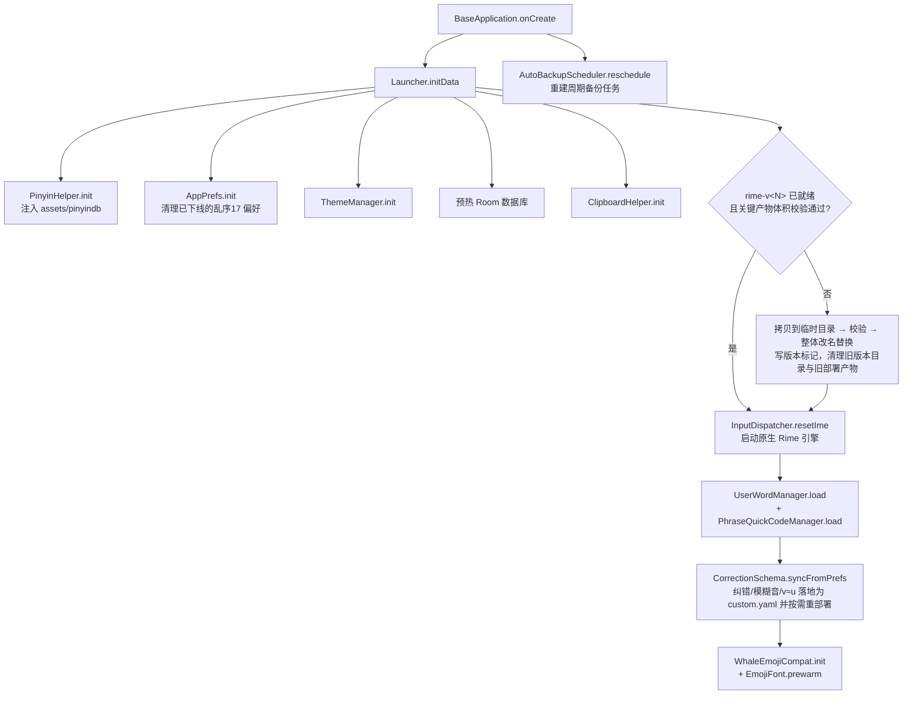

同步初始化与子线程初始化分离：`PinyinHelper`、`AppPrefs`、`ThemeManager`、Room 预热与剪贴板助手必须先完成；词库安装、引擎启动、用户词与常用语索引、纠错补丁、表情兼容与字体预热放在单线程池里串行执行。词库安装是「临时目录 + 体积校验 + 整体改名」的原子流程，拷贝中断不会留下半套数据，下次启动自动重来。

### 输入数据流

界面与引擎之间只有一条咽喉通道：按键经 `KeyDispatcher` 统一判定后交给 `InputDispatcher`，再由它驱动各引擎；候选状态收敛为 `DictDecoder` 中一份不可变快照（`candidateState`），Compose 界面自行订阅渲染，避免多通道状态不一致。

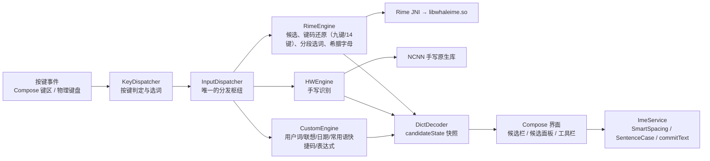

`candidateState` 的 `generation` 区分「整表替换」与「增量追加」，界面据此决定是否重置滚动位置。九键与 14 键的组合串是大写键码，`RimeEngine` 负责把它们还原成拼音展示，并在读音筛选/试打时写回引擎。

### 拼音纠错与模糊音的设计与实现

纠错要解决两件性质不同的事：**拼写容错**（用户按错了键，要还原「本来想打什么」）和**读音规则**（同一读音的另一种合法拼写，如 z/zh、j/q/x/y 后的 v≈u，本身不算错误）。两者的共同前提是：拼音输入本质上是把字母流切成一串音节，词表只按音节 id 检索。因此实现都落在「音节」这一层，而不是对几十万词条做模糊匹配——搜索空间从整张词表降到约四百个音节的音节表，纠错命中后照常查词、排序、学习，一次按键的开销只有毫秒级。

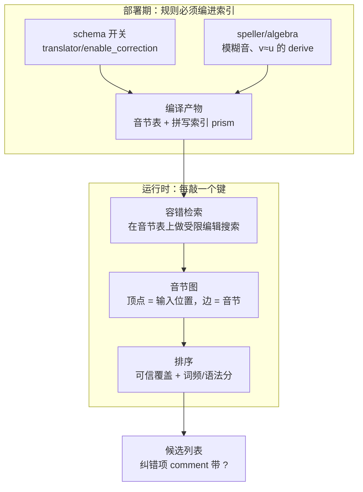

**容错检索：在「音节表 × 输入位置」上做广度优先搜索。** 音节表本身是一棵前缀树（prism），每个节点代表一段拼写前缀。搜索状态是三元组 `(前缀树节点, 已消费的输入位置, 已用误按数)`，从 `(根, 0, 0)` 出发，每次只做「原样前进」和四种编辑操作：

| 转移 | 含义 | 代价 |
| --- | --- | --- |
| 原样前进 | 按键与拼写一致 | 0 |
| 邻键替换 | 按到了隔壁键（QWERTY 几何邻键，含上下排斜向；14 键另有键码邻键表） | 1 |
| 插入字母 | 漏打：树多吃一个字母，输入指针不动（允许连续补 2 个，且必须同一位置） | 1 |
| 删除字母 | 多打：跳过输入字符，树不动 | 1 |
| 相邻换位 | 两个字母颠倒 | 2 |

选 BFS 而不是「拿输入和每个音节逐个算编辑距离」，是因为搜索空间小得可以全枚举：树的深度就是一个音节的字母数（≤6），广度是音节表的有效分支，搜索深度由误按预算封顶，因此状态数只有几十到几百，而逐个比对要 400 次字符串 DP，还无法表达「一个音节吃掉不同多长的按键」。BFS 的层数正好是误按次数，把所有 `≤ 阈值` 的路径走完就穷尽了「这个位置可能是什么音节」；在这一层改用 DFS 并不能更快，也拿不到按代价递增的枚举顺序（DFS 在后面的音节图上另有用途）。误按阈值取 2：移动端手误通常是每个音节错一到两键，上游取 5 会让三个字母的乱码也拼出音节，候选里全是垃圾。

枚举出的每个解释还要过三道闸门：一是**长度比例**，拼写字母数与吃掉按键数的比值必须落在 1/2~2 之间，否则拒掉「两个键解释成七个字母」这类荒谬音节；二是**按「音节 + 跨度」去重**，同一音节可能以不同跨度命中（`hoafe` 的 `hao` 既可由 `ho` 后补一个 a，也可由 `hoa` 换位得到），它们是音节图上长度不同的边，多音节纠错必须靠长跨度那条才能拼出整句，所以不同跨度各自保留、同一跨度只留误按最少的一份；三是**配额**，同一段每个误按档最多留 4 条、总计 6 条，优先「误按少 → 长度偏差小 → 吃掉按键多」，避免用音节 id 做截断时把关键音节（如 `lsishi` 里的 `lao`）整条丢掉。

**从音节边到候选：构图、裁剪与排序。** 输入的位置是顶点，命中的音节是从起点到终点的边，边上记着拼写类型（全拼/简拼/补全/纠错）、是否改过键、误按了几下。构图用按位置递增的优先队列取出顶点，每条边都让位置严格增大，所以是一张有向无环图，每个顶点只处理一次。随后做裁剪：如果整串能被「原样 + 全拼」切完，更差的简拼边和补全边就删掉，而纠错边豁免（其终点也豁免，否则纠错只能出现在最后一个音节）。排序的主键不是「覆盖了多长输入」而是**可信覆盖 = 解释到的字节数 − 误按键数**——否则一个四个音节全改过的长词同样覆盖满整串，会无条件压过精确候选。同分时先比覆盖更远，再比词频与语法分；同一个终点里原样候选先出，纠错候选扣到后面。词条权重里还叠了一档可信度：精确 0、简拼 `log(0.1)`、补全 `log(0.05)`、纠错每错一键 `log(0.01)`，四种解释按同一把尺子竞争。最后，整屏纠错候选限流 4 条（短输入需要提前纠错条目时放宽到 8），否则每个纠错音节带出的整片同音词会挤满候选并拖慢组句；多音节输入在图上做束搜索组句，纠错边以惩罚参与打分，因此整句也能被纠正。

**图上的搜索不止 BFS 一种，选哪种取决于要的是「全部解释」「一条见证」还是「最优代价」。**

| 搜索 | 用在哪 | 为什么 |
| --- | --- | --- |
| 广度优先 | 音节表上做容错检索 | 要枚举所有 ≤2 次误按的解释，层数就是误按数，状态空间小 |
| 深度优先 | 音节图建好后回推候选的切分 | 只要一条路径：按候选编码逐音节往深处走，走到终点即返回，失败自动回溯 |
| 记忆化 DP | 求「原样解释了多少字节 / 错了几键」、数不同切分条数 | 要的是聚合后的最优值或路径数，同一状态会被不同前缀反复到达 |

深度优先出现在候选的「解释」阶段。音节图建好后，每条候选的编码都要回答三件事：它从哪个位置走到哪里、每个音节吃掉哪段输入（preedit 分词就按这个打分隔符）、这条路径里有没有改过键。这些都是**存在性**问题——一条见证路径就够，路径深度只有音节数（≤6），每层分支是该位置能命中的音节数（通常个位数），所以写成一个带路径栈的递归：压栈时记下这一段，找到终点即整体返回，走不通就弹栈换下一条边。这里换成 BFS 只会把「当前这条路径」变成「一整层部分路径」，还得额外保存回溯信息；而 DFS 的栈天然就是答案本身。分支顺序上先试跨度更长的音节，保证拿到的切分与「音节能长则长」一致。上游还留有一条按整词编辑距离建纠错索引的 DFS（枚举删字母后的变体），本项目没有启用：它需要从词表源重建索引，而音节层搜索已经覆盖了同样的误按模型。

需要「最优」而不是「一条」时，递归要加记忆化。判断候选是否改过键，不能看 DFS 碰巧先走到哪条路径，而要在这张有向无环图上求**最优路径**：状态是 `(第几个音节, 输入位置)`，返回该后缀里「原样字节最多、误按最少」的那条，同一状态的结果被缓存复用——不缓存就会沿不同前缀把同一后缀反复展开，退化成指数枚举。同理，判断「这串输入是否存在多种精确切分」是数路径问题，用按位置递增的累加 DP（`ways[end] += ways[pos]`，只走非纠错边，超过阈值即封顶），因为只关心「有没有第二种」，不需要列出所有路径。

以 `hoafe` 想打「好的」为例看中间的每一步。音节表里 `ho` 只是 `hou` 的前缀、`hoa` 根本不是前缀，位置 0 没有任何原样命中，必须靠容错：BFS 给出 `hao` 的两种解释——在 `h` 后补一个 `a`（吃掉 `ho` 两个键，误按 1 次），或把 `o`/`a` 换位（吃掉 `hoa` 三个键，误按 2 次）。两者跨度不同，按「音节 + 跨度」同时留在图上。走到位置 3 时剩 `fe`，同样没有原样音节，`f` 的邻键 `d` 替换一次即得 `de`。词表于是能按 `(hao, de)` 两个音节 id 查到「好的」，权重再叠加每错一键 `log(0.01)` 的罚分；排序时它的可信覆盖是 `5 键 − 3 次误按 = 2`，任何原样满覆盖的候选（cover 5）都排在它前面，没有更强候选时它才居首。

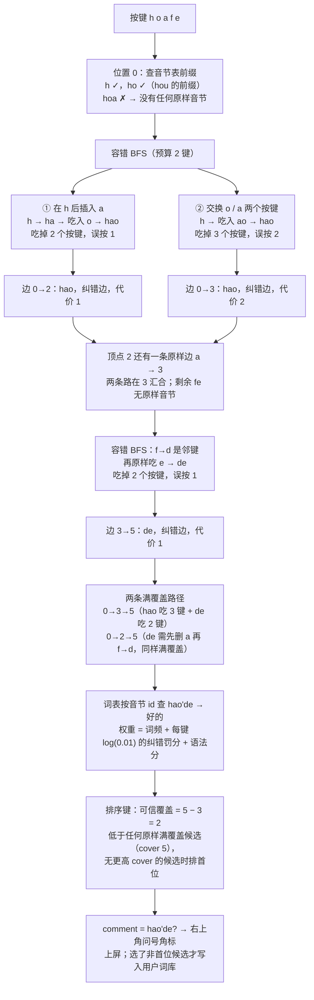

同一串按键在音节图上长这样（边的代价是误按键数，顶点是已消费的按键数）：

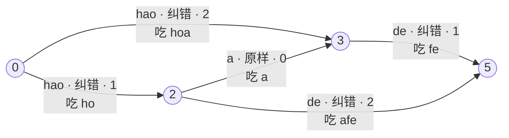

两条满覆盖路径（`0→3→5` 与 `0→2→5`）给出的音节序列都是 `hao'de`，累计误按都是 3 次，因此可信覆盖同为 `5 − 3 = 2`；差别只在于误按落在哪个音节上，排序时按同一把尺子比较。

**模糊音与 v≈u：不是容错，是补一条合法拼写。** 这类变体必须让音节表里真的存在那条键，所以做在部署期的 `speller/algebra`：`derive` 在原拼写之外**追加**变体（z↔zh、c↔ch、s↔sh、n↔l、f↔h、r↔l、an↔ang、en↔eng、in↔ing），`j/q/x/y` 后的 ü 写作 v（只锚定首字母，避免把 `lv`/`nv` 里真正的 ü 误读成 u）。derive 产出的是普通拼写，不扣误按分、不打 `?`。也正因为规则编进了音节表和索引，改开关只能重写用户目录的 schema 补丁并重新部署、重选方案，无法在运行时热改；默认值状态不写补丁。14 键送进引擎的是大写键码，拼音层规则永远匹配不上，所以那套 derive 由脚本逐音节预先换算成键码层规则追加（如 `ZGA → ZA`）；九键一个键代表三四个字母，纠错与模糊都会让歧义爆炸，因此不启用。

### 键盘界面层（Compose）

- `ImeService` 返回缓存的单一 Compose 根视图 `ImeComposeRoot`：旋屏、切换输入框均复用同一份组合，仅在隐藏时把生命周期降到已创建状态，避免反复重建的开销。物理键盘模式下另有 `HardwareCandidateView`（`onCreateCandidatesView` 的 Compose 版本），候选跟随光标浮动，与软键盘自带候选栏互斥。
- `ImeController` 持有全部界面状态（设置页、符号/页码、剪贴板、常用语编辑、候选高亮、编辑键盘浮层等）与缓存失效计数器；`ImeApp` 负责渲染候选栏、单手/悬浮布局、工具栏、常用语弹层与各类容器（键区网格、候选面板、符号面板、剪贴板面板、手写会话等）。
- `KeyboardManager` 不持有任何视图，只暴露两个状态流：当前键盘类型（九宫格、14 键、全键、全键英文、数字、符号、设置、手写、候选、剪贴板、文本编辑、笔画）与缓存失效版本号。
- `KeyboardBuilder` 依据布局数据构建键帽对象并按布局掩码缓存，`InputModeSwitcher` 通过位掩码选择布局；`Environment`（单例）根据偏好与屏幕尺寸计算全部像素尺寸。
- `ThemeManager` 管理 23 款内置主题与自定义主题并通知监听者，主题变更通过键盘版本号失效刷新；自定义主题的背景图裁剪走 `compose/crop`，预览与键盘真实渲染同源。
- 改布局、尺寸、比例、单手或主题后的标准失效序列：`Environment.instance.initData()` + `KeyboardBuilder.instance.clearKeyboardMap()` + `KeyboardManager.instance.clearKeyboard()`；Compose 根还需要 `applyPreferredHeight()`。

### 偏好与持久化

- 偏好采用声明式封装：`AppPrefs` 只做装配与变更广播，设置分在 `Internal`（本机运行期状态，不导出）、`Input`、`KeyboardSetting`、`Feedback`、`Clipboard`、`Handwriting`、`Voice`、`Other` 等分类里，每个字段是带界面元数据的 `ManagedPreference`；设置界面同样由 Compose 按这份元数据渲染（`SettingsGroups` / `SettingsList`，导航为 `SettingsDest` + Compose `NavHost`），没有偏好片段与导航图资源，副作用统一收敛到 `SettingsEffects.onChanged`。`ThemePrefs` 单独管理主题与设置页自身外观。
- Room 数据库 `ime_db`（版本 1，唯一基线；磁盘版本不匹配时重建表）存储侧边符号、剪贴板、常用符号、常用语、工具栏功能开关与用户词表。用户词典的统一读写入口是 `UserWordManager`，它在内存中维护两套索引（「录入时的编码 → 词」与「词本身的读音前缀 → 词」），避免按键路径查询数据库；常用语的快捷码索引由 `PhraseQuickCodeManager` 维护，增删改后需 `reload()`。
- 备份包格式为 zip v2：第一个 entry 是 `manifest.json`（格式版本 + 分类清单），设置项按偏好组拆分、词典/剪贴板/常用语/符号走 jsonl、主题与 `rime-user` 目录单独打包；导入前可只读 manifest 预览内容，支持覆盖与合并两种模式。自动备份固定导出「用户词典 + 学习词 + 剪贴板」三项，周期与 SAF 目录在设置中配置。
- Rime 用户数据（自学习词库 userdb、`*.custom.yaml`、部署产物）与共享词库目录（按版本号隔离的只读 `rime-v<N>`）彻底分离：升级词库即新建版本目录、清理旧版本目录，日常启动零拷贝。纠错/模糊音/v≈u 由 `CorrectionSchema` 写成 `pinyin.custom.yaml` 与 `t14_pinyin.custom.yaml` 补丁并按需重部署。
- 设置会话结束时会把偏好同步到设备加密存储；`Internal` 中的版本标记、剪贴板游标、自动备份目录等本机状态不进入备份包。

## 二次开发指南

### 环境要求

- JDK 21，Android SDK（`compileSdk 36`，`minSdk 33`）；SDK 路径写在自己的 `local.properties`（模板见 [`local.properties.example`](local.properties.example)），或用环境变量 `ANDROID_SDK_ROOT` / `ANDROID_HOME` 指定
- 重建原生引擎需要 NDK 28.0.13004108 与 CMake 3.31.6，并使用 pwsh 7+ 运行 `scripts/build-engine.ps1`；完整流程与踩坑记录见 [`ime-native/README.md`](ime-native/README.md) 与 [`ime-native/native/README.md`](ime-native/native/README.md)
- 克隆即可构建，无需子模块

### 常用命令

```sh
./gradlew :app:assembleDebug             # 构建调试 APK
./gradlew :app:assembleRelease           # 构建压缩/签名发布 APK
./gradlew :app:installDebug              # 安装并启动到设备
./gradlew clean
```

```powershell
pwsh -File scripts/deploy-apk.ps1                  # 编最新 debug 并安装到已连接设备；无设备时自动拉起模拟器
pwsh -File scripts/start-emulator.ps1 -InstallApk -EnableIme
pwsh -File scripts/build-release.ps1 -Clean -Install   # 签名检查 + 打包 + apksigner 验签（可 -OutDir）
pwsh -File scripts/build-engine.ps1 -FetchSources  # 首次：拉引擎源码并编依赖（约 6 个源码包）
pwsh -File scripts/build-engine.ps1 -SkipDeps      # 只重编 JNI 层，约 20 秒/ABI
pwsh -File scripts/precompile-dict.ps1             # 在模拟器上重编 Rime 词库（默认含 23 个细胞词库）
pwsh -File scripts/verify-emoji.ps1                # 校验表情/符号数据与随包字体的字形覆盖
pwsh -File scripts/split-core-res.ps1              # 按引用裁剪 :ime-core 的 res 副本
```

说明：

- 无产品风味，构建类型为 `debug`/`release`，任务名即 `assembleDebug` / `assembleRelease`。
- `versionCode`/`versionName` 按打包时刻自动生成，无需手工维护：`versionCode` 是 2026-01-01 00:00（GMT+8）起的分钟数（严格递增），`versionName` 是 `yyMMdd.HHmm`，APK 文件名为 `whaleIme_<yyMMddHHmm>_<buildType>.apk`。
- 发布签名读取自 `keystore/keystore.properties`（已 gitignore）或 `RELEASE_STORE_FILE` / `RELEASE_STORE_PASSWORD` / `RELEASE_KEY_ALIAS` / `RELEASE_KEY_PASSWORD` 四个环境变量；`debug` 构建同样使用发布签名配置，缺少签名文件时 Gradle **不报错**、直接产出未签名包，打包前建议用 `scripts/build-release.ps1`（会先拦截）。
- `assembleRelease` 不跑 `lintVital`（`checkReleaseBuilds = false`），需要检查时手动执行 `./gradlew :app:lintRelease`。
- ABI：只支持 64 位，`arm64-v8a`（真机/发布）与 `x86_64`（模拟器原生加载验证）；32 位已移除。`scripts/build-engine.ps1` 一次编出两个库，固定先 `x86_64` 后 `arm64-v8a`。debug/release 包都带 `x86_64` 的 `libwhaleime.so`，但手写 `libhccr_jni.so` 默认只编 `arm64-v8a`（ncnn 的 x86_64 预编译库未入库，仅当本地存在时才加编），因此干净 clone 的模拟器上手写入口不可用，拼音引擎验证不受影响。
- 遇到「能构建但运行异常」的问题时，先看 [`ime-native/README.md`](ime-native/README.md) 与 [`ime-native/native/README.md`](ime-native/native/README.md)（原生引擎架构、构建流程与踩坑记录）；构建参数一律以根 `build.gradle` 与各模块 `build.gradle` 为准。

### 扩展指引

- **新增设置项**：在对应分类文件（`preference/InputPrefs.kt`、`preference/KeyboardPrefs.kt`、`theme/ThemePrefs.kt` 等）声明 `ManagedPreference`（数据 + UI 元数据），设置界面与搜索索引会自动收录；若该项会影响键盘或引擎，同时把 key 登记到 `SettingsEffects` 的相应集合，否则改完设置不会立即生效。仅当需要自定义界面时才在 `compose/settings/screens/` 下新增页面，并在 `SettingsDest` 里注册 route（只增不改名）。
- **新增输入方案**：方案 ID 是 `config/SchemaIds` 里的字符串常量，激活方案持久化在 `AppPrefs.internal.pinyinModeRime`，由 `InputDispatcher.initImeSchema` 应用；同时补 `InputModeSwitcher` 的布局位掩码、`KeyboardManager.KeyboardType`、`KeyboardData` 的键位表与界面入口。
- **14 键类「键码方案」**：键位表 `KeyboardData.layoutT14Cn`、`T14KeyMap.CHAR_TO_KEY`（由 `ime-native/native/scripts/gen-t14-algebra.py` 生成）与 `t14_pinyin.schema.yaml` 的 derive 段必须三处同步；每个方案还需独立 prism（14 键是 `t14_pinyin.prism.bin`，与九键共用 `pinyin.table.bin`），由 `scripts/precompile-dict.ps1` 编出。
- **新增候选来源**：仿照 `CustomEngine`（用户词、联想、日期时间快捷、常用语快捷码、表达式计算）接入 `DictDecoder` 管线，保持「界面只经 `KeyDispatcher`/`InputDispatcher` 触达引擎」的分层约束。
- **新增键盘布局**：扩展 `KeyboardManager.KeyboardType` 与 `KeyboardData`，布局选择交给 `InputModeSwitcher` 的位掩码，界面容器在 `compose/keyboard/` 下实现。
- **数据库变更**：修改 `ime_db` 实体时，在 `storage/migration/Migrations.kt` 新增 `Migration` 并追加到 `ALL`，同时提升 `WhaleDatabase` 的 `@Database(version = ...)`；注意数据库以 `allowMainThreadQueries()` 构建，且版本不匹配时会重建表。
- **用户词典与常用语**：用户词所有写入必须经 `UserWordManager`，以保证内存索引同步；常用语变更后调用 `PhraseQuickCodeManager.reload()`。导入导出不单独实现，统一走「设置 - 备份与恢复」的 zip 包。
- **备份分类**：新增分类要同时改 `BackupCategory`（id 与默认勾选）、`UserDataBackup` 的导出/导入分支、备份页勾选项；偏好分类的类名就是备份分组 id，不要改名。
- **主题**：内置主题在 `ThemePreset` 声明后加入 `ThemeManager.BuiltinThemes`（顺序即设置页展示顺序）；自定义主题的读写统一走 `ThemeFilesManager` / `CustomThemeSerializer`。
- **词库/方案资产变更**：必须递增 `config/DictDataVersion.kt` 里的 `CURRENT_RIME_DICT_DATA_VERSIOM`，否则已安装设备不会重新复制词典；引擎与词库的演进历史也记录在该文件的注释里，改动前请先阅读。中文主词库默认含细胞词库（`pinyin.table.bin` 约 59.6 MB），可用 `precompile-dict.ps1 -WithCells:$false` 或 `-CellOnly` 裁剪。
- **原生引擎改动**：改 `ime-native/native/src/**` 后用 `scripts/build-engine.ps1 -SkipDeps` 重编两个 ABI；`com.whale.ime.rime` 与 `com.whale.ime.handwriting` 的包名/符号是原生库 ABI，不能单方面重命名。

本项目不包含单元/自动化测试，验证方式为构建后于真机或模拟器实际运行。

## 鸣谢

感谢以下优秀的开源项目与社区：

- RIME 中州韵 —— <http://rime.im>
- 同文输入法 —— <https://github.com/osfans>
- 语燕输入法 —— <https://github.com/gurecn/YuyanIme>
- 小企鹅输入法 —— <https://github.com/fcitx5-android/fcitx5-android>
- 雾凇拼音 —— <https://github.com/iDvel/rime-ice>
- 白霜拼音 —— <https://github.com/gaboolic/rime-frost>
- 端到端手写汉字识别 —— <https://github.com/Ismantic/Handwritten>
- coddy.tech 颜文字数据 —— <https://coddy.tech/tools/zh/kaomoji>
- Emoji 表情数据（Unicode 官方） —— <https://unicode.org/emoji/charts/full-emoji-list.html>
- Noto Color Emoji 表情字体 —— <https://github.com/googlefonts/noto-emoji>

## 许可证

本项目自身代码以 [MIT 许可证](LICENSE) 开源，可自由使用、修改、分发（含商业用途），保留许可声明即可。

随仓库/APK 分发的第三方组件与数据仍遵循各自许可证，MIT 许可不改变这些条款：

| 用途 | 组件 | 许可证 |
|---|---|---|
| 引擎（`libwhaleime.so`） | RIME/librime 1.17.0、librime-octagram（Copyright © 2014, RIME Developers） | BSD-3-Clause |
| 引擎依赖 | yaml-cpp 0.8.0 | MIT |
| 引擎依赖 | LevelDB 1.23 | BSD-3-Clause |
| 引擎依赖 | OpenCC 1.1.9 | Apache-2.0 |
| 引擎依赖 | marisa-trie 0.3.1 | BSD-2-Clause（或 LGPL-2.1，本项目按 BSD-2 使用） |
| 引擎依赖 | Boost 1.86 | BSL-1.0 |
| 手写识别 | Ismantic/Handwritten 模型与运行时 | Apache-2.0 |
| 拼音（简拼/多音字） | pinyin4j（本地修改版，见 `ime-vendor/.../pinyin4j/package-info.java`） | GPL-2.0-or-later |
| 数字键盘算式 | expression（EvalEx 转写，见 `ime-vendor/.../expression/package-info.kt`） | Apache-2.0 |
| 手写推理 | ncnn | BSD-3-Clause |
| 词库 | 白霜拼音 rime-frost、雾凇拼音 rime-ice | GPL-3.0 |
| 语言模型 | octagram 语法模型 `zh-hans.gram` | CC-BY-4.0 |
| Android 依赖 | AndroidX / Jetpack Compose / Room / Emoji2 / Kotlin 协程 | Apache-2.0 |

- 二次分发 APK/AAR 时，需随包附带上述 BSD/Apache/BSL 组件的版权声明与许可证正文（可另建 `THIRD_PARTY_NOTICES.md` 或在应用内提供「开放许可」页面）。
- 需留意 **GPL 的传染性强于 MIT**：`ime-vendor` 里的 pinyin4j 是 GPL-2.0-or-later 的本地修改版，词库（rime-frost / rime-ice）是 GPL-3.0。上面那句「本项目自身代码以 MIT 开源」只覆盖本仓库自研代码，不构成对整体分发作品的许可结论；对外分发二进制时请按 GPL 的要求一并提供对应源码与许可正文。若后续希望整体收敛到 MIT/Apache 组合，可评估把 pinyin4j 换成 Apache-2.0 的 `TinyPinyin`。
